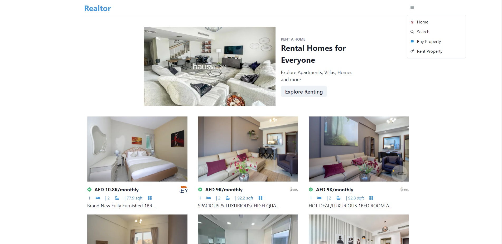
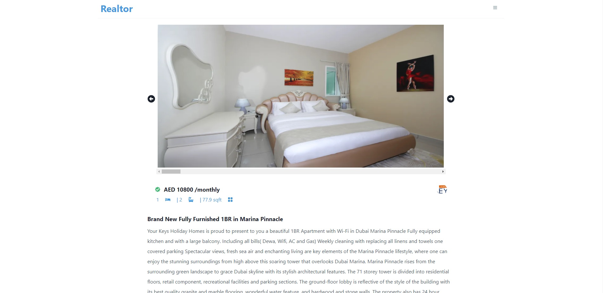

# Grandview-Properties

[](https://nextjs.org/)
[](https://reactjs.org/)
[](https://chakra-ui.com/)
[](LICENSE)

**Grandview-Properties** is a real estate web application built with [Next.js](https://nextjs.org/) and [Chakra UI](https://chakra-ui.com/). The platform enables users to explore, filter, and inspect residential and commercial properties for rent and sale with verified listings, high-resolution photo carousels, and dedicated customer inquiry channels.

---

## Table of Contents

- [Overview](#overview)
- [Key Features](#key-features)
- [Contact Details & Alternative Channels](#contact-details--alternative-channels)
- [Tech Stack](#tech-stack)
- [Project Structure](#project-structure)
- [Getting Started](#getting-started)
  - [Prerequisites](#prerequisites)
  - [Installation](#installation)
  - [Environment Configuration](#environment-configuration)
  - [Running the Application](#running-the-application)
- [Available Scripts](#available-scripts)
- [API Integration](#api-integration)
- [Screenshots](#screenshots)
- [License](#license)

---

## Overview

Grandview-Properties delivers an intuitive property search experience backed by real-time listings from the Bayut Real Estate API. Users can browse featured properties on the home page, perform filtered multi-criteria searches, inspect detailed property pages with photo carousels and amenities, and contact property advisors through primary and 24/7 alternative hotlines.

---

## Key Features

- **Dynamic Property Discovery**: Curated rental homes and for-sale listings displayed on the home page.
- **Advanced Multi-Filter Search**: Filter properties by:
  - Purpose (`For Rent` / `For Sale`)
  - Rent Frequency (`Daily`, `Weekly`, `Monthly`, `Yearly`)
  - Price Range (Min/Max price)
  - Bedrooms, Bathrooms, and Minimum/Maximum Area (sqft)
  - Furnishing status (`Furnished`, `Unfurnished`)
  - Property Type (`Apartment`, `Villa`, `Townhouse`, `Penthouse`, etc.)
  - Sort order (`Price`, `Date`, `Verification status`)
- **Comprehensive Property Detail Pages**:
  - Image carousel powered by `react-horizontal-scrolling-menu`
  - Property specs: rooms, baths, verified agency badges, area, and rental frequency
  - Facilities and amenities breakdown
  - Dedicated Grandview-Properties inquiry banner with direct calling and email options
- **Dedicated Contact Portal (`/contact`)**:
  - Primary headquarters contact details
  - 24/7 Alternative hotline and international support info
  - Interactive inquiry submission form with instant feedback
- **Responsive Layout**: Designed for mobile, tablet, and desktop screens using Chakra UI and custom themes.
- **Smooth Page Transitions**: Page loading bar powered by `NProgress`.

---

## Contact Details & Alternative Channels

Grandview-Properties offers multi-channel support so clients and investors can reach advisors quickly:

### Primary Office & Headquarters
| Channel | Detail |
| :--- | :--- |
| **Address** | Grandview Tower, Suite 1400, Business Bay, Dubai, UAE |
| **Primary Phone** | `+1 (800) 555-0199` / `+971 4 555 0199` |
| **Primary Email** | [info@grandview-properties.com](mailto:info@grandview-properties.com) |
| **Office Hours** | Monday – Saturday: 9:00 AM – 7:00 PM (GST) |

### Alternative & 24/7 Support Channels
| Channel | Detail |
| :--- | :--- |
| **24/7 Alternative Hotline** | `+1 (800) 555-0144` |
| **Mobile / WhatsApp Line** | `+971 50 123 4567` |
| **Alternative Support Email** | [support@grandview-properties.com](mailto:support@grandview-properties.com) |
| **Alternative Sales Email** | [inquiries@grandview-properties.com](mailto:inquiries@grandview-properties.com) |
| **Alternative US Office** | 750 3rd Avenue, 21st Floor, New York, NY 10017, USA |
| **Emergency Response** | Available 24 hours / 7 days a week |

---

## Tech Stack

- **Framework**: [Next.js](https://nextjs.org/) (v12.0.4)
- **UI & Styling**: [Chakra UI](https://chakra-ui.com/) (v1.7.2), [Emotion](https://emotion.sh/)
- **Icons**: [React Icons](https://react-icons.github.io/react-icons/)
- **HTTP Client**: [Axios](https://axios-http.com/)
- **Carousel**: [react-horizontal-scrolling-menu](https://github.com/asmyshlyaev177/react-horizontal-scrolling-menu)
- **Number Formatter**: [Millify](https://github.com/izolate/millify)
- **Loading Indicator**: [NProgress](https://ricostacruz.com/nprogress/)
- **Data Source**: [Bayut RapidAPI](https://rapidapi.com/apidojo/api/bayut)

---

## Project Structure

```text
Grandview-Properties/
├── assets/
│   └── images/
│       ├── house.jpg              # Default fallback property image
│       ├── main_page.jpg          # Homepage preview screenshot
│       ├── noresult.svg           # Empty state search illustration
│       └── property_details.jpg   # Property details preview screenshot
├── components/
│   ├── Footer.jsx                 # Footer with brand & alternative contact info
│   ├── ImageScrollbar.jsx         # Property photo carousel
│   ├── Layout.jsx                 # Global shell layout with Head metadata
│   ├── Navbar.jsx                 # Navigation header with menu links
│   ├── Property.jsx               # Property card component
│   └── SearchFilters.jsx          # Multi-parameter filter dropdowns
├── pages/
│   ├── api/
│   │   └── hello.js               # Sample API route
│   ├── property/
│   │   └── [id].js                # Dynamic property details page with contact banner
│   ├── _app.js                    # Global app wrapper with Chakra & NProgress
│   ├── contact.js                 # Contact page with inquiry form & alt details
│   ├── index.js                   # Homepage with featured properties & CTA
│   └── search.js                  # Filterable property search page
├── public/
│   ├── favicon.ico
│   └── vercel.svg
├── styles/
│   ├── globals.css                # Global base styles
│   └── Home.module.css            # Scoped home module styles
├── utils/
│   ├── fallbackData.js            # Built-in fallback listings and mock data handler
│   ├── fetchApi.js                # RapidAPI Axios client with resilient error handling
│   └── filterData.js              # Filter presets and query parser
├── .env.example                   # Example environment variable file
├── LICENSE                        # MIT License
├── next.config.js                 # Next.js image domain configuration
├── package.json                   # Dependencies and npm scripts
└── README.md                      # Project documentation
```

---

## Getting Started

### Prerequisites

- [Node.js](https://nodejs.org/) (v16.x or later recommended)
- `npm` or `yarn`

### Installation

1. Clone this repository:
   ```bash
   git clone https://github.com/UtkarshPathrabe/utkarsh_realestate.git Grandview-Properties
   cd Grandview-Properties
   ```

2. Install project dependencies:
   ```bash
   npm install --legacy-peer-deps
   ```

### Environment Configuration

Create a `.env.local` file in the root directory (or copy from `.env.example`):

```bash
cp .env.example .env.local
```

Add your RapidAPI Bayut API key:

```env
NEXT_PUBLIC_RAPID_API_KEY=your_rapidapi_bayut_key_here
```

> **Note**: Grandview-Properties features a **built-in resilient fallback layer** (`utils/fallbackData.js`). If the RapidAPI endpoint is unreachable, deprecated, or rate-limited, the application gracefully serves comprehensive curated listings without crashing. You can also connect your own RapidAPI subscription by providing your key and host in `.env.local`.

### Running the Application

Start the local development server:

```bash
npm run dev
```

Open [http://localhost:3000](http://localhost:3000) in your browser to view the application.

---

## Available Scripts

In the project directory, you can run:

- `npm run dev`: Runs Next.js in development mode on port 3000.
- `npm run build`: Builds the application for production deployment.
- `npm run start`: Starts the Next.js production server.
- `npm run lint`: Runs ESLint to check for code quality and formatting issues.

---

## API Integration

This application interacts with the [Bayut API](https://rapidapi.com/apidojo/api/bayut) on RapidAPI:

- `GET /properties/list`: Fetches properties matching location IDs, purpose (`for-sale` or `for-rent`), categories, price ranges, and room counts.
- `GET /properties/detail`: Fetches detailed property metadata including high-resolution photo galleries, amenities list, description, and agency profile.
- `GET /auto-complete`: Provides location auto-complete suggestions.

---

## Screenshots

### Home Page


### Property Details Page


---

## License

Distributed under the MIT License. See [LICENSE](LICENSE) for more details.
